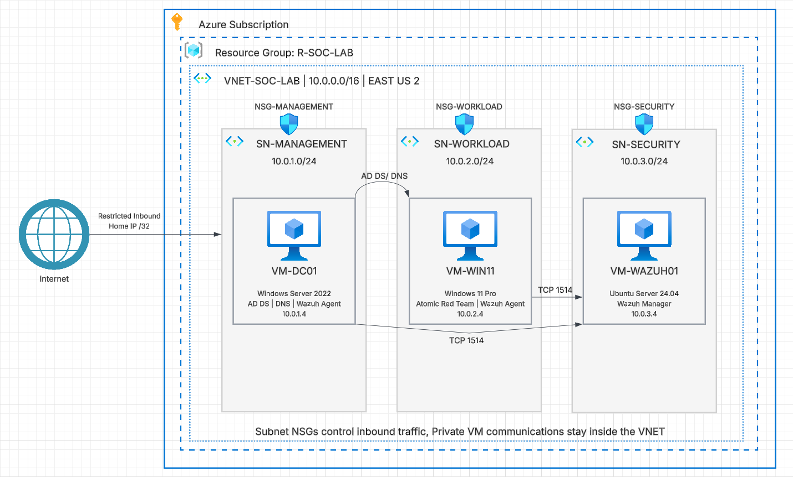
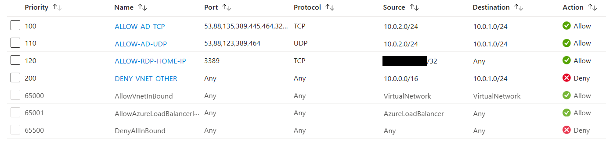
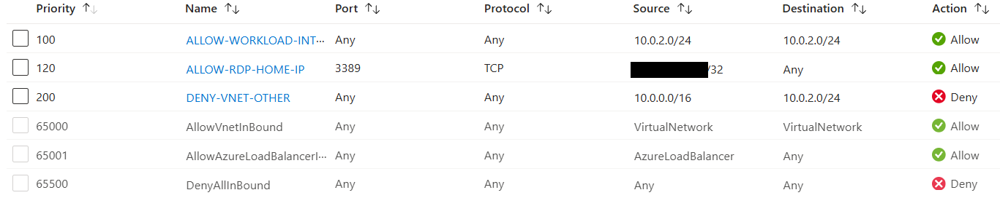
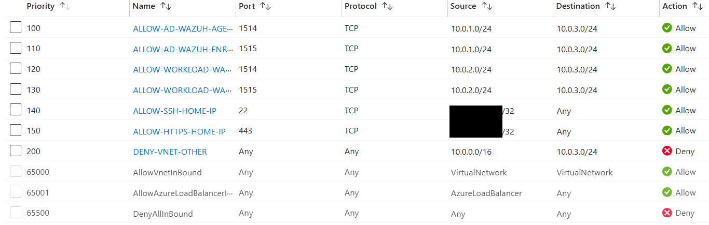

## Lab Architecture

The environment is deployed in Microsoft Azure and organized into three separate network segments within a VNet. Each subnet is reserved for a specific purpose.
The lab currently consists of three virtual machines:

- **VM-DC01 – Windows Server 2022:** Configured as the domain controller, providing Active Directory Domain Services (AD DS) and DNS for the lab environment.
- **VM-WIN11 – Windows 11 Pro:** Represents an employee workstation joined to the domain. It is used for endpoint monitoring, security testing, and simulated IT support scenarios.
- **VM-WAZUH01 – Ubuntu Server 24.04:** Hosts the Wazuh Manager, which centralizes endpoint telemetry and provides security monitoring and alerting.

The three machines are separated into Management, Workload, and Security subnets. Each subnet has an associated Network Security Group to control network traffic. This design was made with a foundation for exploring how enterprise environments separate administrative systems, user endpoints, and security infrastructure in mind.

### Network Security Groups

Each subnet has an associated NSG to control inbound and outbound traffic.

**NSG-MANAGEMENT**
- Priority 100: Allow Active Directory TCP traffic.
- Priority 110: Allow Active Directory UDP traffic.
- Priority 120: Allow RDP (TCP 3389) from home public IP (`/32`).
- Priority 200: Deny other VNet inbound traffic.

**NSG-WORKLOAD**
- Priority 100: Allow internal workload subnet traffic.
- Priority 200: Deny other VNet inbound traffic.

**NSG-SECURITY**
- Priority 100: Allow Wazuh agent traffic from `SN-MANAGEMENT` (TCP 1514).
- Priority 110: Allow Wazuh enrollment from `SN-MANAGEMENT` (TCP 1515).
- Priority 120: Allow Wazuh agent traffic from `SN-WORKLOAD` (TCP 1514).
- Priority 130: Allow Wazuh enrollment from `SN-WORKLOAD` (TCP 1515).
- Priority 140: Allow SSH (TCP 22) from home public IP (`/32`).
- Priority 150: Allow HTTPS (TCP 443) from home public IP (`/32`).
- Priority 200: Deny other VNet inbound traffic.

## Active Directory & Identity Management

- **Domain:** soclab.local
- **Domain Controller:** VM-DC01 (Windows Server 2022)
- **Services:** Active Directory Domain Services and DNS.
- **Organizational Units:** Executive, IT, HR, Finance, Operations, Users, Computers, Groups.
- **Test Accounts:** jsmith and atomic.test.
- **Domain Join:** VM-WIN11 successfully joined to soclab.local.

## Wazuh Deployment & Endpoint Monitoring

- **Wazuh Manager:** VM-WAZUH01 (Ubuntu Server 24.04).
- **Monitored Endpoints:** VM-DC01 and VM-WIN11.
- **Agent Status:** Both Windows agents connected and active.
- **Monitoring:** Windows security events, authentication events, and process creation events.
- **File Integrity Monitoring (FIM):** OSSEC.conf <syscheck> configured for C:\SOC-FIM-Test.

## MITRE ATT&CK Emulations
### T1078.002
#### Objective and Scope
